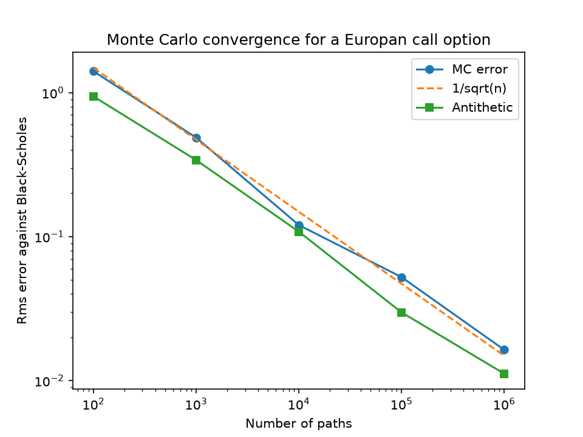

# Monte Carlo option pricer in python

## With Black-Scholes equation validation and antithetic variance reduction

## *Results*

Parameters: $S_0 = 100$, $K = 100$, $r = 5\%$, $\sigma = 20\%$, $T = 1$ year.



| Black-Scholes Price | Monte Carlo Price | $\pm$ SE at $10^6$ paths | Difference              |
| ------------------- | ----------------- | ------------------------ | ----------------------- |
| 10.4506             | 10.4532           | $1.473 \times 10^{-2}$   | $2.6117 \times 10^{-3}$ |

Antithetic variance cuts the standard error by ~29.4% at the same path count

## *How it works*

Stocks are modelled in one step to terminal price with Geometric Brownian motion

$$
S_T = S_0\exp\left(\left(r - \tfrac{1}{2}\sigma^2\right)T + \sigma\sqrt{T}\,Z\right)
$$

Price = discounted average payoff, $e^{-rT}\,\overline{\max(S_T - K,\,0)}$

Standard error = payoff standard deviation over $\sqrt{N}$

Black-Scholes used as the benchmark

## *Design choices*

**Why we use r over $\mu$**

aths are simulated with drift $r$, not the real-world growth rate $\mu$. The option can be replicated with the stock and a bond, so its price does not depend on $\mu$ or on investors' appetite for risk. The only rate that matters is $r$, the cost of borrowing and lending.

**Why antithetic works**

Each path gets a random number Z, antithetics means we also run the corresponding -Z. A call pays more when the stock ends high, so if $Z$ gives a high payoff, $-Z$ tends to give a low one.

Averaging the pairs together means we get a less noisy, more accurate average

**Why we average the pairs before we work out the error**

The error formula treats everything as independent path however the two paths in a pair are linked, but different pairs are independent, so each pair is averaged into one sample.

**Why the covergence study uses RMSE over 20 repeats**

One runs error is down to luck, so I repeat 20 times and take the typical size of the error

## Validation

- Our Monte Carlo price agrees with the Black-Scholes equation within sampling error
- Error falls at $1/\sqrt{N}$ across $10^2$->$10^6$ paths

## Limitations

- Constant volatility
- Constant rate
- No dividends
- European only

### Possible extensions:

- Puts, via put-call parity
- Full path simulation and Asian options

## How to run

```bash
pip install -r requirements.txt

python pricer.py

python -m pytest
```
